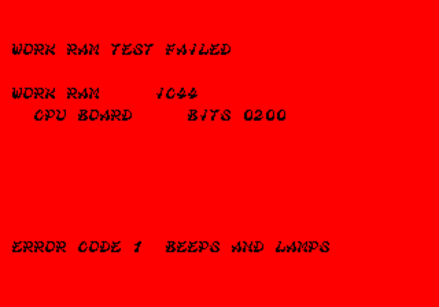
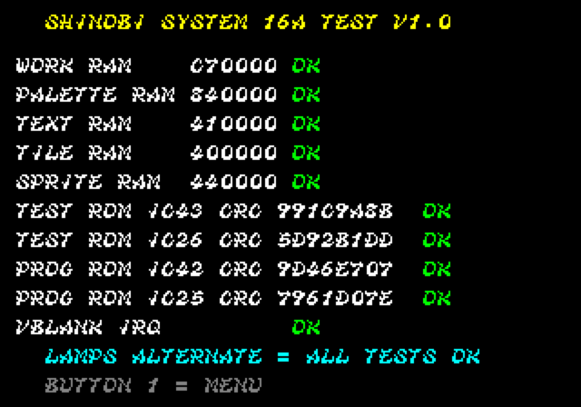
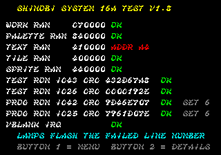
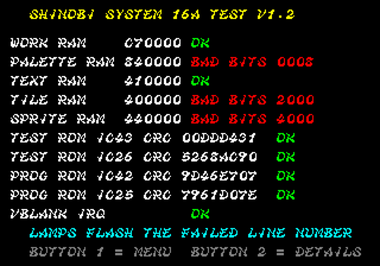
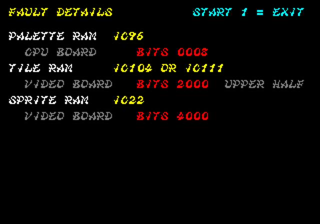
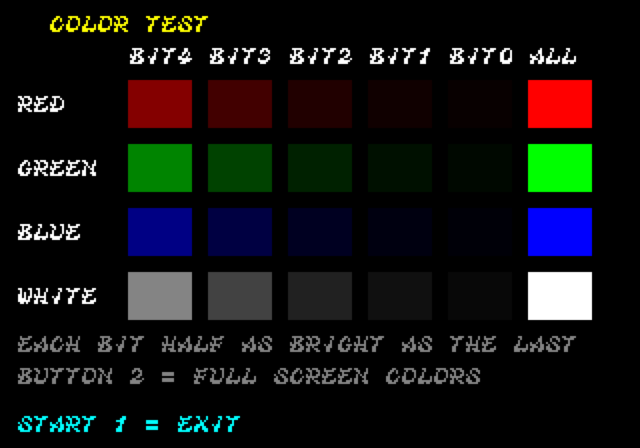
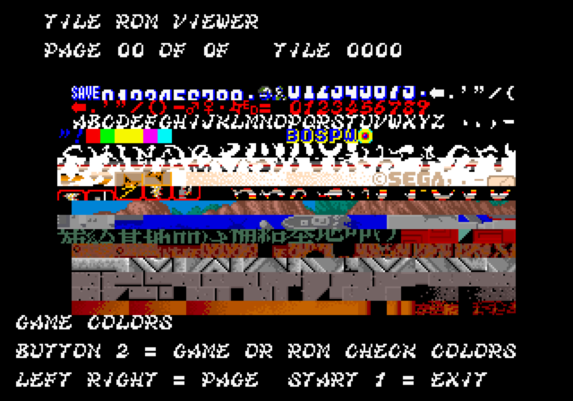
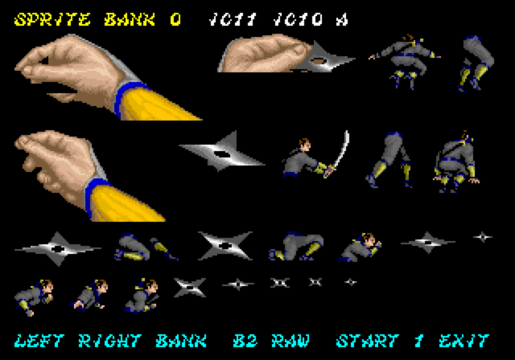
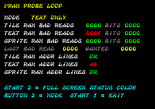
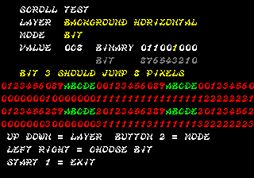

# Shinobi System 16A test ROM

A diagnostic ROM (v1.9) for repairing a Sega System 16A board (171-5306 CPU board + 171-5307 video board) running **Shinobi with a plain 68000**. It replaces the first pair of program ROMs and tests the board's RAM, ROMs, video, inputs and sound. It reports results in three ways: **on screen**, by **flashing the start lamps and clicking coin meter 1**, and by **beeping through the speaker**. So you can still read the result when the screen stays black, or when no lamps or meters are connected.

It will not run on the FD1094 (encrypted CPU) version of Shinobi.

When a RAM or ROM fails, the test names the **chip and the board** it's on, for example "WORK RAM IC44, CPU BOARD, BITS 0200". The chip numbers come from Sega's 171-5306 / 171-5307 schematics (see *Board map* below).

## Files

| File | What it is |
|---|---|
| `out/IC43_test_even.bin` | Burn to a 27C512 → socket **IC43** (68000 data D15–D8) |
| `out/IC26_test_odd.bin` | Burn to a 27C512 → socket **IC26** (68000 data D7–D0) |
| `src/shinobi_test.s` | 68000 source |
| `tools/build.py` | Assembles and splits the ROM |
| `src/gfxdata.inc` | Game palettes and sprite list for the viewers (generated) |
| `tools/make_gfxdata.py`, `tools/capture.lua` | Regenerate `gfxdata.inc` from a MAME run of the original game |
| `docs/screenshots/` | What every screen should look like (from MAME) |
| `docs/Shinobi_Test_ROM_Guide.pdf` | Printable user guide (v1.9) |
| `tools/make_guide.py` | Builds the PDF guide from MAME screenshots (needs ReportLab: `python3 tools/make_guide.py <screenshot folder> <output.pdf>`) |

## Installing it

1. Burn the two `.bin` files to two **27C512** EPROMs. These sockets already hold 27C512s on Shinobi, so no jumpers change. Check the programmer's checksum after burning.
2. Pull the original **IC43** (EPR-12010) and **IC26** (EPR-12008) from the CPU board and keep them safe.
3. Fit the test EPROMs in their place, with the notch facing the same way as the originals. Don't swap them: IC43 gets the `even` file and IC26 the `odd` file.
4. Leave **IC42** and **IC25** in their sockets. The test ROM CRC-checks them.

## What happens at power-on

The first steps use no RAM at all, so they work even if the RAM is dead.

The very first thing the ROM does is give an **alive signal** using the 8255 (IC10) on the CPU board: both lamps go on, and after about 0.2 s you hear **one beep**. The lamps go on before any other access. If the CPU then stalls on its first access to the palette or video hardware (the 68000 just waits forever when nothing answers), you still get the lamps, and normally the beep too.

The board has a **watchdog** that resets the CPU when the program stops reading `$C60000` for a short time. On a real board this was about 0.2 s. The test ROM reads it at least every few frames everywhere, including during the 0.2 s wait. Version 1.3 didn't do that during the wait, which made a working board reset about 5 times per second.

| You see / hear | Meaning |
|---|---|
| No lamps and no beep | The 68000 isn't running the test ROM at all. See *If the screen stays black* below. |
| Lamps on and one beep, but the screen stays black and the lamps stay on | The CPU runs the ROM but stalls on its first access to the watchdog, palette or video side. Look at the palette RAM (IC96/IC97), its buffers, and the access logic between the CPU and video boards. |
| **Blue** screen, lamps on for ~0.4 s more, then off | The CPU is running, and the palette and video output work. Then work RAM is tested. |
| The board **resets over and over**, several times a second (lamps flicker, maybe a beep each time) | The watchdog keeps firing. With v1.4 the ROM always kicks it, so the CPU must be stalling or crashing before it can. Probe 68000 pin 6 (/AS) and the address pins as in *If the screen stays black*. |
| **Red** screen | Work RAM: **IC44** (D15–D8) has bad bits |
| **Green** screen | Work RAM: **IC27** (D7–D0) has bad bits |
| **Yellow** screen | Work RAM: both IC27 and IC44 have bad bits (suspect shared logic or the bus too) |
| **White** screen | Work RAM: address or decoding fault (data is fine, but cells overlap) |
| **Magenta** screen, code 11 | The CPU crashed. The screen shows the vector: 2 = bus error, 3 = address error, 4 = illegal instruction. Suspect the CPU, ROM sockets or the address and data bus. |
| Results screen | Everything else was tested. See below. |

The coloured work RAM screens also print each bad chip in black text, in the same two-line format as the fault details page: the RAM and chip on the first line, the board and bad bits (or the bad address) on the second. This is done without using any RAM, so it works even with dead work RAM, as long as the text RAM, palette RAM and tile ROM IC95 are OK.



Blue only stays up briefly. The screen goes black for a few seconds while the video RAMs are tested, and then the results screen appears.

### Lamp, coin meter and beep codes

The two start lamps (lamp outputs 1 and 2) are always driven:

- **Lamps alternate slowly:** every test passed.
- **Both lamps flash N times, then pause:** the test in line N failed. The first round also clicks **coin meter 1**.
- **A second group of flashes** after a longer gap: the RAM in line N has an **address fault**, and the number of flashes is its lowest bad address line. For example 3 flashes, gap, 4 flashes = text RAM, address line **A4**. A data fault (bad bits) gives no second group.
- **Beeps:** each flash also plays a short sound effect (sound code `A3`) through the speaker, so you can count the code (and the second group) by ear without lamps or meters. For work RAM failures and CPU crashes the beeps repeat for as long as the board is on. For other failures they sound only in the first round, so the menu stays quiet.

The beeps come from the sound section (its own Z80, RAM and sound ROM IC12, on the CPU board), so they work even when the 68000's work RAM is dead. If you hear nothing at all, either the sound section is also faulty or the CPU isn't running the test ROM.

| Flashes | Failed test |
|---|---|
| 1 | Work RAM (`$C70000`, 16 KB) |
| 2 | Palette RAM (`$840000`, 4 KB) |
| 3 | Text RAM (`$410000`, 4 KB) |
| 4 | Tile RAM (`$400000`, 32 KB) |
| 5 | Sprite RAM (`$440000`, 2 KB) |
| 6 | Test ROM in IC43 (bad burn or bad socket) |
| 7 | Test ROM in IC26 |
| 8 | Program ROM IC42 (second program ROM pair, even) |
| 9 | Program ROM IC25 (second program ROM pair, odd) |
| 10 | No VBLANK interrupt from the video hardware |
| 11 | CPU exception (crash) |

If you can't hear the beeps and have no lamps wired, put an LED (with a resistor) or a logic probe on the lamp outputs of the edge connector. Get the pin numbers from the Shinobi manual.

## Results screen



- **`OK`**: passed.
- **`BAD BITS xxxx`**: those data bits failed. Bits `FF00` mean the RAM chip on D15–D8, and `00FF` the chip on D7–D0. A single bit (for example `0004`) usually means one chip, or one buffer or trace on that data line.
- **`ADDR A4 A9`**: the data bits are fine, but some addresses share one cell. The test lists the **CPU address lines** that don't work: here A4 and A9. A missing line makes the CPU write two places into one cell, so on the text layer you'd see characters doubled, or gaps every few characters or rows. Video RAM addresses go through buffers (IC82/IC78 on the video board), the PAL IC56 or the Sega custom chips, so follow the line from the 68000 (A1 = pin 29 … A11 = pin 39) to the RAM and check those as well as the RAM.


- **ROM lines** show the computed CRC32. IC42 and IC25 are checked against every known Shinobi version, and the version found is shown next to them:

  | Shown | Version | IC42 (even) | IC25 (odd) |
  |---|---|---|---|
  | **SET 6** | set 6, unprotected (MAME `shinobi`) | EPR-12011 `9D46E707` | EPR-12009 `7961D07E` |
  | **SET 1** | set 1 (FD1094, `shinobi1`), its decrypted bootleg (`shinobi1d`), the Star and Beta bootlegs | EPR-11263 `A2A620BD` | EPR-11261 `A3CEDA52` |

  If only one chip matches a version, that one shows `OK` and the other `BAD`, with the version of the matching chip. No version shown means neither chip matches anything known. `BAD` can mean a bad ROM, a dirty or loose socket, a bent pin or an empty socket. The 16A's sockets are known for poor contact, so reseat and clean them first.



Press **Button 1** for the menu (joystick up/down + Button 1 to choose). If something failed, press **Button 2** for the fault details.

## Fault details

This page names each bad chip, always in the same two-line format:

```
PALETTE RAM  IC96
  CPU BOARD     BITS 0008
TILE RAM     IC104 OR IC111
  VIDEO BOARD   BITS 2000  UPPER HALF
```

- **Line 1:** which RAM or ROM, and which chip.
- **Line 2:** which board, then `BITS xxxx` for bad data bits, `ADDR A4 A9` (the bad address lines) for an address fault, or `CRC BAD` for a ROM.
- If both chips of a pair have bad bits, each gets its own entry.
- The work RAM error screen uses the same format, except that for an address fault it shows the first bad address (`ADDR xxxxxx`).



A named chip is where the fault shows up, not always its cause. A bad bit can also be a dirty socket, a broken trace or a bus buffer between the chip and the CPU. Check those before replacing the RAM.

**Tile RAM** is four chips. IC105 and IC112 carry D7–D0, and IC104 and IC111 carry D15–D8. One pair holds the lower half of tile RAM and the other the upper half, but the schematics don't show which pair is which. The test checks the two halves separately and says which half failed, so the answer is one of two chips. If both halves fail on the same data bits, suspect the shared buffers rather than two bad RAMs.

## Menu pages

**Input and DIP test.** Shows the live state of the SYSTEM, PLAYER 1 and PLAYER 2 inputs and both DIP banks. `1` means pressed or DIP on. Press Start 1 and Start 2 together to exit.

**Color test.** Each colour row lights one DAC bit at a time, then all of them. Each cell should be about half as bright as the one to its left. A missing or wrong cell points at that bit of the colour resistor network or its palette latch. Button 2 cycles full-screen white, red, green, blue and black, which helps when checking the monitor.



**Tile ROM viewer.** Shows all 8192 background tiles, 512 per page (left/right changes page). Button 2 switches between two colour modes:

- **Game colours** (the default) use the palettes Shinobi itself sets. They were captured from the game's attract mode in MAME, so scenery, the font and the SEGA logo look as they do in the game. Compare with `docs/screenshots/tiles_game0.png`.
- **ROM check colours** draw each tile ROM as one bit plane in its own colour: **red = IC93**, **green = IC94**, **blue = IC95**. A missing colour, or garbage in one colour only, points at that ROM. Compare with `docs/screenshots/tiles_planes2.png`.

The game's font lives entirely in **IC95**. If IC95 is dead, or its data lines are bad, you get no readable text anywhere. Use the lamp codes in that case.



**Sprite ROM viewer.** Shows real game sprites, one page per sprite bank, in the game's colours. Left/right changes bank. The title names the two ROMs for that bank: the first ROM listed (IC11/18/24/30) supplies the left two pixels of every four, and the second (IC10/17/23/29) the right two. `A` means the first half of each ROM, `B` the second half. The sprite list was captured from the attract mode, so some banks show only a few sprites (bank 7 has just two). Compare with `docs/screenshots/sprites_bank0.png` to `sprites_bank7.png`. Typical faults:

- Thin vertical stripes or missing colours in every sprite of one bank: one ROM of that pair.
- Garbage in every bank: shared sprite logic or the bus on the video board, not a ROM.

Button 2 switches to the raw data view, which draws the bytes of all 8 banks as strips. Left/right scrolls through it.



**Fault details.** See *Fault details* above. Shows "NO RAM OR ROM FAULTS FOUND" on a good board.

**Sound test.** Sends a command byte to the Z80 sound CPU. Up/down changes it by 1, left/right by 16, Button 1 plays, Button 2 stops. Codes `81`–`9A` and `A0`–`BF` all make sound in MAME. If no code makes any sound, the page lists the parts to check on the CPU board: Z80 **IC11**, sound ROM **IC12**, Z80 RAM **IC13**, YM2151 **IC9**, YM3012 **IC3** and the MB3733 amplifier.

**VRAM probe loop.** Keeps the CPU writing and reading tile RAM, text RAM or sprite RAM over and over, so the select and write strobes on the video board pulse all the time and can be followed with a logic probe. It uses spots that aren't on screen or used by the hardware (tile RAM page 7, text RAM column 0, sprite RAM entry 127), so the page stays readable. It shows how many of the last 1000 reads came back wrong, in red when any did. Button 2 cycles **all / tile only / text only / sprite only**, and beeps the new mode number (1 to 4). Mode 1 (**all**) tests tile, text and sprite RAM together: a quick overall check. Modes 2–4 narrow a fault down to one RAM. Next to each counter, **BITS** shows every data bit that has read back wrong since the mode was last changed. One bit points at one data line or chip (D7–D0 = low-byte chip, D15–D8 = high-byte chip); many bits at once point at an address line or timing. **LAST BAD READ** shows the most recent wrong value and what it should have been: `FFFF` means nothing answered (a select or buffer enable, or a "done" signal that comes too early); the previous pattern (`AAAA` instead of `5555` or the other way round) means the write was lost; anything else points at an address problem. A counter shows `0000` when its RAM isn't being tested in that mode.

The data test uses one fixed address per RAM, so on its own it can't see a missing address line: every access lands in the same wrong cell and reads back fine. So once per screen update the loop also checks **every address line** of each RAM in the mode: it writes the word at the base address and the word that differs in just that line, then checks whether one overwrote the other, and puts both words back. **ADDR LINES** lists the bad lines seen since the mode was last changed (for example `A4 A9`, in red), or `OK`. A bad address line also counts as a bad read, so the counter and the full-screen colour show it too. Tile RAM checks A1–A14, text RAM A1–A11 and sprite RAM A1–A10.



What to probe in each mode is described in *Using the VRAM probe loop* below.

If the screen is too distorted to read, press **Start 2** for a **full-screen status colour**. Start 2 again goes back to text:

| Colour | Meaning |
|---|---|
| green | no bad reads |
| red | tile RAM bad reads |
| blue | text RAM bad reads |
| yellow | tile and text |
| magenta | sprite RAM bad reads |
| white | sprite RAM together with tile and/or text |

A bad read keeps its colour for half a second, so occasional errors show as a steady colour instead of a flicker. Combine it with the modes: for example, red in modes 1 and 2 but green in modes 3 and 4 means only tile RAM fails.

**Scroll test.** Checks that the two tile layers can be scrolled to every position. One layer shows a ruler of hex digits (the column number's low digit, its high digit, and the row number in every 8th column); the other layer is blank. The page shows the scroll register value in hex and in binary, with the bit numbers underneath.

- **Up/down** chooses the layer and direction: background horizontal, foreground horizontal, background vertical, foreground vertical. Horizontal scroll has 9 bits (0–511 pixels), vertical 8 bits.
- **Button 2** cycles the mode:
  - **AUTO** scrolls 1 pixel every 2 frames. The ruler should glide smoothly, with no pauses, steps or jumps back.
  - **STEP**: each left/right press moves the layer exactly 1 pixel (hold to repeat).
  - **BIT** switches one bit of the scroll register on and off every half second. Left/right chooses the bit (shown in yellow), and the line under the value says how far the layer should jump: 1 pixel for bit 0 up to 256 pixels for bit 8.
- **Start 1** exits.

In BIT mode, step through all bits of a layer. A bit where the ruler doesn't move at all, or jumps the wrong distance, is the dead one. If one layer fails and the other works, the fault is in that layer's own scroll path, not in text RAM (the scroll registers live there, and text RAM is tested at power-on). Typical symptoms in a game: a missing low bit (0–2) makes the layer move in steps; a missing higher bit makes it jump back or forward by a large amount every few steps.



**Rerun all tests.** Restarts from the beginning.

## If the screen stays black

If you get no lamps and no beep, the 68000 isn't getting through its first few instructions. Check, in this order:

1. **+5 V at the board:** 4.9–5.1 V, measured at the CPU board, not at the power supply.
2. **Reset:** the 68000 (**IC30**) /RESET and /HALT lines must go high after power-up. The MB3771 reset chip (very likely **IC66**) drives reset.
3. **Clock:** 10 MHz on the 68000 clock pin.
4. **The test EPROMs themselves:** seated, right way round, IC43 and IC26 not swapped.
5. **A stuck bus:** a logic probe on the 68000's address lines should show activity (pulsing). A line stuck high or low points at a shorted chip or trace.
6. **/HALT, /BERR and /BR:** all three must be high while the CPU runs. On the 171-5306, /HALT and /BERR also go to the 8751 socket (IC61). MAME's notes say these boards use a small plug-in adapter (837-0068) there instead of a real 8751, so check it's present and seated.
7. **No lamps but beeps:** the lamps and coin meters go through the 8255 (**IC10**) and the driver **IC4**.

If you get lamps and the beep but no blue screen, the CPU runs but stalls on its first access to the video side (see the table under *What happens at power-on*).

### Finding where the CPU stalls

If the screen goes black and stays black with no beeps, check 68000 pin 6 (/AS). If it's stuck low, the CPU is frozen in the middle of a memory access, and its address pins still show the address. Read A23 (pin 52), A22 (51), A18 (46), A17 (45), A16 (44) and R/W (pin 9, low = write):

| A23 A22 A18 A17 A16 | Stuck on | Its "done" signal comes from |
|---|---|---|
| 1 0 1 0 0 | Palette RAM `$84xxxx` | CPU board logic |
| 0 1 0 0 1 | Text RAM `$41xxxx` | **V.DTACK** from IC56 (CK2605) on the video board |
| 0 1 0 0 0 | Tile RAM `$40xxxx` | **V.DTACK** from IC56 (CK2605) on the video board |
| 0 1 1 0 0 | Sprite RAM `$44xxxx` | CPU board logic |
| 1 1 1 1 0 | Watchdog `$C6xxxx` | CPU board logic |

Text and tile RAM share V.DTACK. IC56 sends it once it finds a free slot in the video timing, using T0–T7 from **IC48** (74LS164). IC48 is fed by **HT** from PAL **IC58** pin 19, which needs **H0–H2** from the horizontal counter **IC59** (74LS669) pins 14, 13 and 12. A dead IC59 gives exactly this stall: on one board, IC59 pins 12 and 13 were stuck high and IC58 pin 2 (H0) was floating, while the screen still flashed blue.

If the lamps flash but the screen stays black, the CPU side works and the fault is in the video path. The lamp code still tells you which RAM test failed. If every test passes (lamps alternating) and the screen is still black, look at the video output stage, sync and the monitor connection.

## Using the VRAM probe loop

The probe loop keeps the CPU accessing one kind of video RAM continuously. Every select, strobe, address and data line on that path then toggles steadily, so you can go along the chips with a logic probe or scope. The method that found every fault on the reference board:

- **Compare like with like:** a working chip next to a suspect one (buffer A against buffer B, the high-byte chip against the low-byte chip, tile mode against text mode).
- **A pin that never changes, sits at an in-between level (floating), or behaves differently from its twin is the suspect.** Then follow that signal back to where it comes from.
- **Intermittent faults:** use the full-screen status colour (Start 2) and try freeze spray or a hair dryer on one chip at a time. A chip that makes the colour change is the culprit.

Chips involved in each mode, on the **171-5306 / 171-5307** boards (171-5335 grid names in brackets where known):

| Mode | What it exercises | Chips to look at (video board) |
|---|---|---|
| 1 all | tile, text and sprite RAM together; AD16 toggles all the time | the shared tile/text path: address buffers **IC82, IC78** (74LS244); read latches **IC44, IC52** (74LS374) and their gates **IC36**; "done" signal V.DTACK from **IC56** (CK2605), timed by **IC48** (74LS164) |
| 2 tile only | tile RAM | select decoders **IC72, IC64** (74LS139; H12, J12); data buffers **IC108, IC113** (74LS245); tile RAMs IC105, IC112 (D7–D0), IC104, IC111 (D15–D8) |
| 3 text only | text RAM | select decoders **IC72, IC64**; data buffers **IC101, IC94** (74LS245); text RAMs IC97 (D7–D0), IC90 (D15–D8) |
| 4 sprite only | sprite RAM | RAMs **IC28** (D7–D0, E8) and **IC22** (D15–D8, E7); their data goes to **IC27** (315-5011, E9); addresses, /CS and write strobe from **IC21** (315-5012, E6) and **IC14** (74LS163, G6) |

### Mode 2 and 3: the tile/text select decoders

Address bit **AD16** chooses between tile RAM (`$40xxxx`, AD16 = 0) and text RAM (`$41xxxx`, AD16 = 1). Pin numbers from the 171-5335 drawing (check against your chips):

| Decoder half | Enable | Inputs | Outputs |
|---|---|---|---|
| Select (IC72, first half) | pin 1 = VRAM | pin 2 = CPU, pin 3 = AD16 | **pin 5 = SCRG** (tile), **pin 7 = FIXG** (text) |
| Low-byte write (second half) | LWR | AD16 | **SLWR** (tile), **FLWR** (text) |
| High-byte write (IC64) | UWR | AD16 | **SUWR** (tile), **FUWR** (text) |

| Signal | Mode 1 (all) | Mode 2 (tile) | Mode 3 (text) |
|---|---|---|---|
| VRAM, LWR, UWR | pulse | pulse | pulse |
| AD16 | pulses | **low** | **high** |
| SCRG, SLWR, SUWR (tile) | pulse | pulse | quiet |
| FIXG, FLWR, FUWR (text) | pulse | quiet | pulse |

### Mode 4: sprite RAM

The two sprite RAMs (TMM2018, 2K × 8) share their address lines, /CS (pin 18, from IC21 pin 47), /OE (pin 20, tied to GND) and /WE (pin 21, one strobe for both). Only their data lines differ: IC28 pins 9–11, 13–17 for D7–D0, IC22 for D8–D15. A fault on one byte only (`BITS 00FF` or `FF00`) therefore points at that chip or its data lines to IC27.

### Scroll faults (use the scroll test)

The scroll values are stored in text RAM (horizontal at `$410FF8` foreground and `$410FFA` background, vertical at `$410F24` / `$410F26`). The tilemap chips **IC73 / IC74** (315-5049) read them and use them for the tile layers. The upper bits pick which tiles are fetched (coarse scroll, whole 8-pixel tiles). The lowest 3 bits of each layer shift its pixels by 0–7 (fine scroll): they leave the chips as **FVA0–2** and **FVB0–2** and go to **IC86** (K21, 74LS157), which switches between the two layers.

**Best method: compare with the twin layer.** The foreground and background scroll circuits are built twice, almost identically. When one layer scrolls wrongly and the other is fine, follow the faulty layer's scroll bit along its **whole net, across both boards**, and compare it point by point with the same bit of the working layer. The place where the two differ is the fault. Check the main board as well as the daughter board: on a bootleg the daughter board is the obvious suspect, but the break can just as well be on the main board.

**Solved case on this board:** the background layer misbehaved on horizontal scroll bit 3. The cause was a **broken trace on the main board from IC85 pin 9 (74LS74) to IC57 pin 12**. It was found by comparing with the working foreground path:

| | Daughter board | Header | Main board |
|---|---|---|---|
| Foreground (working) | E4 pin 1 (74LS85) | pin 15 of header 73 | IC85 pin 6 → IC57 pin 1 |
| Background (faulty) | H5 pin 1 (74LS85) | pin 5 of header 75 | IC85 pin 9 → **broken** → IC57 pin 12 |

On this bootleg, background scroll bits 0–3 only go to the 74LS85 comparator H5; E4 is its foreground twin. A static level on H5 pin 1 (B3) is normal. The daughter-board chips E2 and E7 (74LS374) share the same data and are **not** a foreground/background pair, so comparing them with each other doesn't help.

**Other things to check:**
- **One layer steps, the other is smooth:** a fine-scroll bit of that layer. On a board with the original tilemap chips, the lowest 3 bits leave IC73 / IC74 as FVA0–2 and FVB0–2 and go to IC86 (74LS157). This is from a hard-to-read schematic and wasn't the cause on this board, so trace the twin nets first.
- **A layer jumps by 8 pixels or more:** a coarse bit (bit 3 and up), like the case above. Trace that bit from the tilemap chip or daughter board to where it's used on the main board, and compare it with the other layer.

### Sprite line buffers (no probe mode needed)

If sprites miss **every other scanline**, one of the two line buffers isn't working. They're always active while sprites are on screen (use the sprite ROM viewer):

| | Buffer A | Buffer B |
|---|---|---|
| RAMs (2148-55, 1K × 4) | IC87, IC79, IC75 | IC88, IC80, IC76 |
| Write latch (74LS374) | IC71 | IC63 |
| Third-RAM data buffer (74LS244) | IC55 half 1 | IC55 half 2 |
| Address multiplexers (74LS157) | IC53, IC61, IC69 | IC54, IC62, IC70 |
| Read-out selectors (74LS157, shared) | IC89, IC81, IC77 | |

The two buffers store their bits in a different order, so compare **activity** between them, not pin for pin. The multiplexers' enable pins (pin 15) are tied to GND; on the reference board, IC69 pin 15 had lost that connection, which removed every other sprite line.

## Board map

From Sega's 171-5306 / 171-5307 schematics (Channelmaniac's annotated "Sega_16A_Schematics-cm.pdf"). The grid names in brackets are the same chips on the 171-5335 / 171-5336 board revision ("System 16A 2.0 Schematics.pdf"), for boards printed with grid positions instead of IC numbers.

| What | D7–D0 chip | D15–D8 chip | Board |
|---|---|---|---|
| Work RAM (2064) | IC27 (M7) | IC44 (M9) | CPU 171-5306 |
| Palette RAM (2016) | IC96 (B22) | IC97 (B20) | CPU 171-5306 |
| Program ROMs | IC26, IC25, IC24 | IC43, IC42, IC41 | CPU 171-5306 |
| Text RAM (2016) | IC97 (M18/M19) | IC90 (L18/L19) | Video 171-5307 |
| Tile RAM (2064) | IC105, IC112 (M10, M12) | IC104, IC111 (M13, M15) | Video 171-5307 |
| Sprite RAM (2016-type) | IC28 (E8) | IC22 (E7) | Video 171-5307 |

Other parts:

| Part | Chip | Board |
|---|---|---|
| 68000 CPU | IC30 | CPU |
| 8255 I/O (lamps, meters, sound command) | IC10 | CPU |
| Lamp and coin meter driver | IC4 | CPU |
| Input multiplexers / DIP buffers | IC5–IC8 / IC14, IC15 | CPU |
| MB3771 reset | IC66 (very likely) | CPU |
| Z80, sound ROM, Z80 RAM | IC11, IC12, IC13 | CPU |
| YM2151, YM3012 | IC9, IC3 | CPU |
| Tile ROMs | IC93, IC94, IC95 | CPU |
| Sprite ROMs | IC10/17/23/29 (low byte), IC11/18/24/30 (high byte) | Video |
| Sprite chips 315-5011, 315-5012 | IC27, IC21 | Video |
| Tilemap chips 315-5049 | IC73, IC74 | Video |
| Tile/text RAM select decoders (74LS139) | IC72, IC64 | Video |

IC numbers repeat between the two boards (IC97, IC27, IC10…), so always check the board as well. The text RAM grid name is M18/L18 on one schematic and M19/L19 on the other.

## Rebuilding

Requires `m68k-elf-binutils` (Homebrew) and Python 3.

```bash
python3 tools/build.py
```

To also build a MAME ROM set from your `shinobi.zip`, with the test ROM in place of IC43/IC26:

```bash
python3 tools/build.py --mame shinobi.zip
```

To run it in MAME:

```bash
mame shinobi -rompath out/mame
```

MAME will warn about wrong checksums for `epr-12010.43` and `epr-12008.26`. That is expected: those files are now the test ROM.

## Limits

- **Tested in MAME only (0.289), not yet on real hardware.** The memory map, I/O and video formats come from MAME's System 16A driver. The boot screen, every menu page, the sound path, and detection of work RAM, palette, text, tile and sprite RAM faults and ROM faults were all checked in MAME.
- Chip names come from the schematics, not from a board, so check them against your PCB. The tile RAM half-to-chip mapping is unknown (see *Fault details*).
- The 68000 can't read the tile, sprite or sound ROMs, so those are checked visually or by ear, not by CRC.
- All System 16A Shinobi versions use the same tile, sound and (almost all) sprite ROMs, so the screen text, the beep and the viewers work with every version. The Star bootleg has two different sprite ROMs (IC29/IC30 position, bank 3), so that bank looks different in the sprite viewer.
- The game colours and sprite list come from Shinobi's attract mode only. Tile palettes the attract mode never sets are shown in grey.
- The Z80 sound RAM isn't tested.
- Sprite RAM ignores the last word of each 16-byte entry, because the sprite hardware writes there itself.
- The RAM tests catch stuck, shorted and missing bits and address faults. They can miss timing faults that only show at full game speed.
- Lamp timing uses software delay loops, so flash lengths are approximate.
- The watchdog timeout was estimated from one real board (about 0.2 s). In MAME the ROM never goes more than 3 frames (about 0.05 s) without kicking it.
- The alive beep waits about 0.2 s for the sound CPU to start after reset. If your sound section starts more slowly, that first beep could be missed. The lamps still come on.
